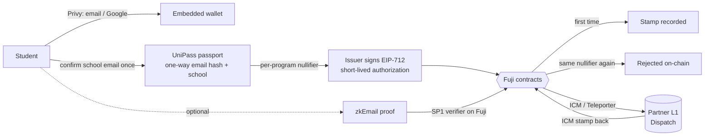

# UniPass — your student passport on Avalanche

**Verify once with your school email. Get one stamp per program — enforced by smart contracts on Avalanche.**

🌐 **Live app:** https://unipass-pi.vercel.app (Avalanche Fuji testnet)

Campus events, airdrops, scholarships and student deals all have the same problem: one person can register ten times with ten emails or ten wallets. UniPass gives each student a private passport. Every program can stamp it **once**, and the contract rejects a second stamp — even from a different wallet.

| App | What a student does | What the contract enforces |
| --- | --- | --- |
| **Events** | Register and get a non-transferable QR ticket | One ticket per student per event, capacity limit |
| **Polls** | Vote in club elections and showcases | One vote per passport; the voter's wallet is not in the vote tx |
| **Giveaways** | Claim test USDC | One claim per passport, paid from the program's own budget |
| **Scholarships** | Apply anonymously with a short answer | Sponsor awards within a capped budget, never sees email or wallet |
| **Student discounts** | Get a one-time code + QR | One code per passport; merchant redeems it once |
| **Ecosystem** | "Sign in with UniPass" for partner quests | One unique student per quest, signed attestation for partners |
| **Interchain (ICM)** | Send the passport to another Avalanche L1 and bring a stamp back | Passport + return stamp travel through Avalanche Interchain Messaging |

All seven work directly on the homepage — no navigation needed.

---

## How it works



1. **Sign in** with Privy (email or Google). An embedded wallet is created; UniPass sponsors gas, so students never need AVAX.
2. **Verify once.** The student confirms a `.edu.vn` school email (Privy OTP, or a DKIM-signed `.eml` as fallback). UniPass stores only a keyed one-way hash of the email and the school domain. The passport is valid for 180 days.
3. **Get stamped.** For each program the server derives a different HMAC nullifier from the identity hash, program ID, chain ID and contract address. The issuer signs a short-lived EIP-712 authorization; the contract checks it and refuses any nullifier it has already seen. A new wallet does not create a second student, and nullifiers from different programs cannot be linked.

Program rules: `OPEN` (any signed-in wallet), `STUDENT` (any verified school), `SCHOOLS` (listed school domains only).

## Built on Avalanche

| Feature | How Avalanche is used |
| --- | --- |
| **Stamps on Fuji C-Chain** | Every stamp, vote, ticket, claim and award is an on-chain transaction with a public tally |
| **Interchain Messaging (ICM)** | `UniPassPassportBridgeV1` sends the passport to a partner L1 through TeleporterMessenger; `CampusQuestL1` on the L1 sends a stamp back. Real round trip Fuji ↔ Dispatch L1, delivered by the Avalanche relayer in ~2–9 s |
| **zkEmail verified on-chain** | The official Succinct SP1 v6.1.0 Groth16 verifier is deployed on Fuji; `UniPassZkEmailV1` checks the proof and the school's DKIM key hash |
| **Low fees** | UniPass pays gas for students (gas drip + relayer), which is only practical on Avalanche |
| **Safe multisig** | Treasury and admin rights sit in a Safe 2-of-3 on Fuji |

## Live contracts

All Fuji contracts are **verified on Snowtrace**.

| Contract | Network | Address |
| --- | --- | --- |
| EventManager V2 | Fuji | [`0xFC6289Cc8e4dA635138815d75D84172C17135817`](https://testnet.snowtrace.io/address/0xFC6289Cc8e4dA635138815d75D84172C17135817) |
| Ticket V2 (non-transferable ERC-721) | Fuji | [`0x0e84c98597647C73Ac64bae8cd25e0eb8F92353f`](https://testnet.snowtrace.io/address/0x0e84c98597647C73Ac64bae8cd25e0eb8F92353f) |
| Poll V1 | Fuji | [`0x03Dd8Ba6D1e2b80Ce0947eD97b07a80876d9dDf0`](https://testnet.snowtrace.io/address/0x03Dd8Ba6D1e2b80Ce0947eD97b07a80876d9dDf0) |
| Programs V2 (giveaways, scholarships, discounts, ecosystem) | Fuji | [`0xD779787Da728441DdE4E19ED5E036af9571aF016`](https://testnet.snowtrace.io/address/0xD779787Da728441DdE4E19ED5E036af9571aF016) |
| tUSDC (test token, no value) | Fuji | [`0x1b06E7C3F80E236A5792D75f0571Cf3935ddAC84`](https://testnet.snowtrace.io/address/0x1b06E7C3F80E236A5792D75f0571Cf3935ddAC84) |
| UniPassZkEmailV1 | Fuji | [`0xA77A0B32F798D7a26e647d638288FD5726F3D37e`](https://testnet.snowtrace.io/address/0xA77A0B32F798D7a26e647d638288FD5726F3D37e) |
| SP1 Verifier (Groth16 v6.1.0, unmodified) | Fuji | [`0x3403FA3C107a4FdF96E0F24153E03b9dF84E5b47`](https://testnet.snowtrace.io/address/0x3403FA3C107a4FdF96E0F24153E03b9dF84E5b47) |
| PassportBridge V1 (ICM) | Fuji | [`0x54F904075875590EACAA6A4F1A8Ec2d88B946901`](https://testnet.snowtrace.io/address/0x54F904075875590EACAA6A4F1A8Ec2d88B946901) |
| Safe 2-of-3 (treasury & admin) | Fuji | [`0x78b503A7B1d45699a643cA65fCB5e238d05DDE45`](https://testnet.snowtrace.io/address/0x78b503A7B1d45699a643cA65fCB5e238d05DDE45) |
| PassportMirror V1 | Dispatch L1 | [`0xFC6289Cc8e4dA635138815d75D84172C17135817`](https://explorer-test.avax.network/dispatch/address/0xFC6289Cc8e4dA635138815d75D84172C17135817) |
| CampusQuest L1 | Dispatch L1 | [`0x0e84c98597647C73Ac64bae8cd25e0eb8F92353f`](https://explorer-test.avax.network/dispatch/address/0x0e84c98597647C73Ac64bae8cd25e0eb8F92353f) |

Programs V1 (`0x8F24B0C6eB23952E52E7a389149914ee08a416Da`) is retired: its programs are closed, its balance moved to the Safe, and ownership handed to the Safe.

## Security model

| Role | Can do | Cannot do |
| --- | --- | --- |
| **Safe 2-of-3** | Mint tUSDC, withdraw unused program budgets, change issuers, register school DKIM keys, configure ICM routes | — |
| **Operator** (server relayer) | Create programs, submit stamps, award scholarships | Pay more than a program's budget or a scholarship's max award; withdraw funds |
| **Issuer** (server key) | Sign short-lived, program-scoped stamp authorizations after checking eligibility | Stamp the same nullifier twice (the contract refuses) |

**Tests**

- `forge test` — **18 Foundry tests**, including 4 stateful invariant suites (64 runs × 64 calls each):
  - one stamp per (program, nullifier), never above the cap;
  - contract balance always equals the sum of program budgets, and every payout is accounted for;
  - one vote per passport, with tallies always equal to the vote count;
  - one event registration per student even across wallets, and tickets can't be transferred.
  - Also covered: zkEmail (including the real VNU proof fixture), the ICM round trip, and the rejection paths.
- `npm run test:unit` — 62 unit tests (nullifiers, eligibility policy, DKIM, EIP-712 builders, zkEmail public values, ICM encoding).
- `npm test` runs both.

**What is still trusted:** for Privy-based passports, the issuer server decides who is a student. The zkEmail path removes that trust for the email check: the school's DKIM signature is verified in a zero-knowledge proof and checked on-chain.

## zkEmail

On `/my-passport`, a verified student can add a **"ZK-verified on Avalanche"** stamp:

1. Send a challenge from the school mailbox and upload the original `.eml`.
2. The zkEmail prover turns the DKIM signature into an SP1 proof. The email goes only to the zkEmail prover, never to UniPass.
3. The student's wallet submits the proof to `UniPassZkEmailV1`, which verifies it with the SP1 verifier. It accepts only a registered school DKIM key: `from_domain_hash` = sha256(domain), `public_key_hash` = sha256(PKCS#1 key).

The email address is never on-chain; each proof can be used once. Register a new school's key through the Safe with `node --env-file=.env scripts/zkemail/register-dkim-key.mjs <domain> <selector>`.

Current limits (blueprint `PhamPhuongg13/UniPass_Student_Verification@v2`):
- Only `vnu.edu.vn` is accepted today.
- The proof does not bind the wallet, so uniqueness still comes from the passport nullifier.

A v3 blueprint (non-capturing regex, challenge = wallet) will fix both.

## Interchain Messaging (ICM)

The passport can travel to another Avalanche L1 without a bridge, without tokens, and without calling UniPass servers:

1. **Fuji → L1.** `sendPassport` checks an issuer-signed attestation and sends `(wallet, schoolHash, expiresAt, zkVerified)` through TeleporterMessenger (`0x253b2784c75e510dD0fF1da844684a1aC0aa5fcf`). `PassportMirrorV1` on the L1 accepts messages only from the bridge on Fuji.
2. **On the L1.** `CampusQuestL1` lets a mirrored student claim a quest once. The student signs a message; a relayer pays the L1 gas.
3. **L1 → Fuji.** The quest sends an ICM message back, and the bridge records the stamp on the student's Fuji passport.

Any L1 can read `isStudent(address)` on the mirror. The demo uses Ava Labs' Dispatch testnet L1 (blockchain ID `0x9f3be606…a4b1c7`) as the partner L1.

## Sign in with UniPass (for partners)

1. Create an Ecosystem program at `/ecosystem/new` with an exact callback URL.
2. Send users to `/connect?program=<id>&redirect_uri=<callback>&state=<random>`.
3. After the student approves, UniPass stamps the program once and redirects with `attestation`, `signature` and `state`.
   - The attestation is an EIP-712 `UniPassAttestation`: program, nullifier, school, issued/expiry, contract.
   - Verify it with `/api/attestations/verify`, or recover the issuer (`/api/attestations/issuer`) and read `nullifierUsed(chainProgramId, nullifier)` on Programs V2.

`/partner-demo` shows the full flow; `/developers` lists the read calls and types.

## Run locally

Requirements: Node 22+, Postgres (e.g. Docker), Foundry (for tests).

```bash
npm install --legacy-peer-deps      # postinstall runs prisma generate
cp .env.example .env                # fill in values (see below)
npx prisma migrate deploy
npm run dev
```

Key environment variables (all keys are **Fuji testnet only**):

| Group | Variables |
| --- | --- |
| App | `APP_ORIGIN`, `DATABASE_URL`, `NEXT_PUBLIC_AVALANCHE_RPC_URL` |
| Privy | `NEXT_PUBLIC_PRIVY_APP_ID`, `PRIVY_APP_SECRET` |
| Identity | `EMAIL_NULLIFIER_SECRET`, `UNIPASS_REGISTRATION_ISSUER_PRIVATE_KEY`, `REGISTRATION_ISSUER_ADDRESS`, `STUDENT_EMAIL_SUFFIXES` |
| Relayer & gas | `POLL_RELAYER_PRIVATE_KEY`, `POLL_RELAYER_ADDRESS`, `GAS_FAUCET_PRIVATE_KEY`, `GAS_DRIP_*` |
| Contracts | `NEXT_PUBLIC_EVENT_MANAGER_ADDRESS`, `NEXT_PUBLIC_TICKET_ADDRESS`, `NEXT_PUBLIC_POLL_ADDRESS`, `NEXT_PUBLIC_PROGRAMS_ADDRESS`, `NEXT_PUBLIC_TUSDC_ADDRESS`, `NEXT_PUBLIC_SAFE_ADDRESS` |
| zkEmail | `NEXT_PUBLIC_ZKEMAIL_ADDRESS`, `NEXT_PUBLIC_SP1_VERIFIER_ADDRESS`, `NEXT_PUBLIC_ZKEMAIL_BLUEPRINT_SLUG` |
| ICM | `L1_RPC_URL`, `L1_BLOCKCHAIN_ID`, `NEXT_PUBLIC_L1_NAME`, `NEXT_PUBLIC_L1_CHAIN_ID`, `NEXT_PUBLIC_PASSPORT_BRIDGE_ADDRESS`, `L1_MIRROR_ADDRESS`, `L1_QUEST_ADDRESS`, `NEXT_PUBLIC_L1_EXPLORER_URL` |

Server-side RPC calls time out after 15 s and fall back to a second public Fuji RPC. Relayer sends are serialized with a Postgres advisory lock.

### Deploy scripts

| Script | Purpose |
| --- | --- |
| `scripts/contracts/deploy-v2.mjs`, `deploy-poll.mjs` | Event manager + ticket, poll |
| `scripts/contracts/deploy-zkemail.mjs` | SP1 verifier + zkEmail contract |
| `scripts/contracts/deploy-icm.mjs`, `test-icm.mjs` | ICM bridge (Fuji) + mirror and quest (L1); real round-trip test |
| `scripts/contracts/migrate-to-safe.mjs` | Safe 2-of-3, Programs V2, treasury and ownership handover (idempotent, resumable) |
| `scripts/contracts/verify-snowtrace.mjs` | Verify a deployed contract on Snowtrace |
| `scripts/safe/exec.mjs` | Execute an admin call through the Safe |

All deploy scripts refuse non-Fuji chains and refuse to overwrite an existing `deployments/*.json` without `--force`.

## Hackathon notes

- **Why on-chain?** Stamps and tallies are public and cannot be edited by UniPass, organizers or sponsors. Anyone can check that each passport was stamped once.
- **Why Avalanche?**
  - Fees are low enough for UniPass to pay every student's gas.
  - ICM lets partner L1s (games, schools) trust a UniPass passport natively.
  - Fuji hosts the SP1 verifier for zkEmail.
- **Where does the money come from?**
  - Sponsors fund their own program budgets: giveaways, scholarships.
  - Partners pay for "Sign in with UniPass" integrations.
  - Students never pay.
- **Declared for the demo:**
  - Everything runs on Fuji testnet. tUSDC is a test token with no value.
  - Dispatch L1 stands in for a partner's own L1.
  - The program operator funds demo budgets on behalf of sponsors.
  - zkEmail currently accepts VNU only.
- **Vietnam law:**
  - Crypto is not legal tender in Vietnam. UniPass sells no token, takes no money from users, and is free for students.
  - A real scholarship would be paid in VND; on-chain, UniPass only records that an award was made.
  - On-chain data is limited to hashes, school-domain hashes and stamps — no names, emails or student IDs.
- **Limitations:**
  - A school email cannot tell current students from alumni, so passports expire after 180 days.
  - The issuer server is trusted for non-zkEmail passports.

## License

UniPass contracts are MIT (see the SPDX headers). Vendored third-party contracts keep their own licenses. See `contracts/sp1/SOURCE.txt` (Succinct, MIT) and `contracts/icm/SOURCE.txt` (Ava Labs Ecosystem License).
